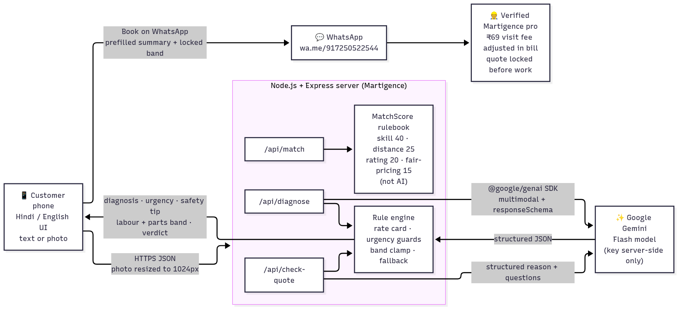
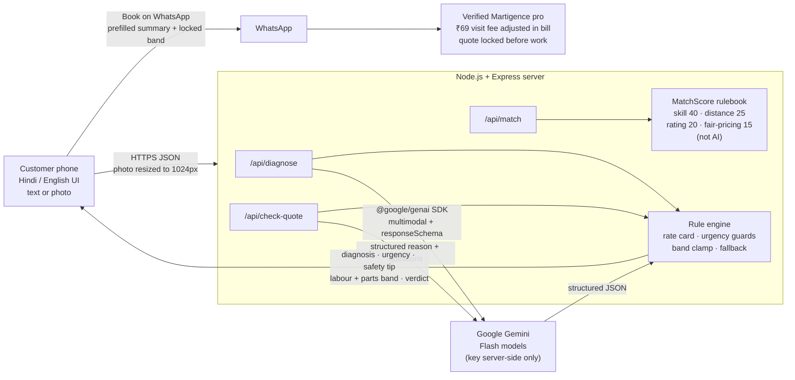

# Dikhao aur Jano (दिखाओ और जानो)

**Show a home problem. Know the fair price.**

Martigence is a verified home-services platform for small Indian cities, starting in Deoghar, Jharkhand. *Dikhao aur Jano* (“show and know”) lets a customer describe or photograph a home problem in Hindi, Hinglish or English. The app returns the likely problem, how urgent it is, a safety tip, and a fair labour-and-parts price band — then helps the customer check a pro’s quote and book on WhatsApp with that band locked.

**Live demo: [martigence-dikhao-aur-jano.vercel.app](https://martigence-dikhao-aur-jano.vercel.app)**

Also deployed on Google Cloud Run: [martigence-dikhao-aur-jano-542822577542.asia-south1.run.app](https://martigence-dikhao-aur-jano-542822577542.asia-south1.run.app)

Built solo by Roushan Singh, Martigence, for [Startup Buildathon India 2026](https://hack2skill.com).

## The problem

In small cities like Deoghar, a leaking tap or a sparking switchboard often means calling an unknown electrician or plumber and hoping the quote is fair. Labour and parts get mixed into one number. There is no published rate card, no way to check if ₹600 for a simple tap leak is reasonable, and no clear signal when a fault is actually dangerous.

Families are asked to decide quickly, in a language and a price range they may not be sure about. That is how overcharging happens — and how a sparking board can be treated as “we’ll see tomorrow.”

## The solution

The customer types the problem or adds a photo. Google Gemini (called only on the server) reads the text and, if present, the image, and returns structured JSON: the likely problem, the right pro category, urgency, a safety tip, and separate labour and parts bands from a Deoghar starting rate card.

A transparent rule engine then checks the model’s answer. Sparking, a gas smell or flooding is forced to **urgent**, even if the model underplays it. Price bands are clamped to the rate card. If Gemini is unavailable, the same rule engine still returns an estimate, so the screen is never blank.

If a pro has already quoted a price, the **Pro Extra-Charge Checker** compares it with the band. The verdict is arithmetic, not a model opinion. Gemini only writes a short explanation and polite questions to ask the pro.

## Features

- **Hindi / English UI**, with Hinglish input accepted (for example, “Bathroom ka nal lagatar tapak raha hai”).
- **Text or photo.** Photos are resized in the browser to 1024px JPEG before upload.
- **Diagnosis:** likely problem, pro category, urgency, safety tip, labour band, parts band, possible parts, what the pro should check, and optional follow-up questions.
- **Urgency guards in code:** sparking, burning smell, smoke, a live wire, electric shock, a gas leak or smell, flooding or a burst pipe — all raise urgency to `urgent`. The guard can only raise urgency, never lower it.
- **Pro Extra-Charge Checker:** enter the pro’s total quote. Verdicts are `fair`, `slightly_high`, `too_high`, or `suspiciously_low`. Example: a tap leak band of ₹150–₹400 with a quote of ₹600 returns **Too high +₹200**.
- **MatchScore pro picker:** ranks nearby pros with a public rulebook — skill 40, distance 25, rating 20, fair-pricing record 15. Nobody can pay to rank higher. The list is labelled **SAMPLE DATA** (example pros, not real people).
- **Book on WhatsApp** with a prefilled summary: problem, pro type, urgency, locked fair band, ₹69 visit fee (adjusted in the bill), and the checked quote if one was entered.
- **Product rules shown in the app:** the band is locked before work starts; above the band the pro must send a reason and photos, and the customer can take a free second quote or pay only the visit fee; *Kaam ki Guarantee* — if the same fault returns within 7 days, the same pro comes back free.
- **Accessibility:** skip-to-content link, labelled inputs, 18px base type, large tap targets, visible focus rings, `aria-live` results, a language toggle, and reduced motion when the system asks for it.

Starting rate card (18 common jobs, labour and parts in INR, Deoghar estimates that a pro confirms at the visit): leaking tap, pipe leak, toilet/flush, drain block, water motor, switchboard, ceiling fan, wiring fault, inverter, door/lock, furniture, AC service, AC gas refill, room painting, wall touch-up, appliance repair, RO service, and a general inspection visit.

## Google AI integration

Gemini is used as a structured diagnostician, not as a free-form chatbot. The official `@google/genai` SDK runs **only in `server.js`**. The API key never reaches the browser.

| What | How |
| --- | --- |
| Models | `gemini-3.8-flash` first (thinking level `LOW`, 16s timeout), then `gemini-3.5-flash-lite` (11s timeout). The last model that worked is tried first on the next request. Override with `GEMINI_MODEL` in `.env`. (`gemini-2.5-flash` returns 404 for new API keys, so it is not in the chain.) |
| Structured output | `responseMimeType: application/json` plus a `responseSchema` with enums for `category`, `job_key`, `urgency` and `confidence`. Temperature is `0.2`. |
| Image input | If the customer attaches a photo, it is sent as multimodal `inlineData` (JPEG) alongside the text. The model fills `photo_seen`. |
| Languages | The system instruction asks for simple Hindi (Devanagari) or simple English, matching the UI language. |
| Rate card in the prompt | The 18-job Deoghar labour/parts card is passed into the system instruction so quotes stay close to local bands. |
| Quote checker | Gemini writes a 1–2 sentence reason and 2–3 questions to ask the pro. The **verdict itself always comes from the rule engine**. |
| Fallback | If there is no key, a timeout, a quota error or a model failure, `rules.fallbackDiagnose()` still returns a keyword-based estimate and a friendly note. |

After every Gemini (or fallback) response, `rules.applyGuards()` runs in code: valid category and job, urgency override, and labour/parts clamped to within 2× of the rate card so a hallucinated number cannot mislead.

## Architecture





**AI proposes, rules decide.** A longer walkthrough of each layer, the API shapes, quote thresholds and product rules is in [docs/ARCHITECTURE.md](docs/ARCHITECTURE.md).

## Tech stack

- **Runtime:** Node.js 18+ (CommonJS)
- **Server:** Express 5
- **Google AI:** `@google/genai` (Gemini Flash, structured JSON, multimodal)
- **Frontend:** a single mobile-first page in `public/index.html` (no framework)
- **Rules:** `rules.js` — rate card, urgency guards, quote verdict, MatchScore, fallback
- **Config:** `dotenv`, with `.env` re-read on every request

## Project structure

```
.
├── server.js          # Express app, Gemini calls, API routes
├── rules.js           # Rate card, guards, quote math, MatchScore, fallback
├── public/
│   └── index.html     # Hindi/English UI
├── docs/
│   ├── ARCHITECTURE.md
│   └── architecture.png
├── .env.example       # Template only — no secrets
├── .gcloudignore      # Keeps .env and node_modules out of Cloud Run uploads
├── package.json
├── LICENSE            # MIT
└── README.md
```

`server.js` exports the Express `app` (`module.exports = app`) so a host can import it, and listens on `PORT` only when started with `node server.js` or `npm start`.

## Quick start

```bash
git clone https://github.com/Martigence/martigence-dikhao-aur-jano.git
cd martigence-dikhao-aur-jano
npm install
cp .env.example .env
# Add your Gemini API key to .env (see .env.example).
npm start
```

Open [http://localhost:8080](http://localhost:8080). The port is `process.env.PORT`, default `8080`.

Without a key, the app still runs and shows a rule-based estimate. With a free Gemini key from [Google AI Studio](https://aistudio.google.com/apikey), diagnoses use the model chain above.

## Deployment

| Where | Details |
| --- | --- |
| **Google Cloud Run** (primary) | Region `asia-south1` (Mumbai), deployed from source with `gcloud run deploy --source .` (Buildpacks build, image stored in Artifact Registry). Scales 0–2 instances, 512 MiB. Public URL: [martigence-dikhao-aur-jano-542822577542.asia-south1.run.app](https://martigence-dikhao-aur-jano-542822577542.asia-south1.run.app) |
| **Secret Manager** | The Gemini API key is stored as the secret `gemini-api-key` and mounted into Cloud Run as the `GEMINI_API_KEY` environment variable. It is never in the repo, the image or the browser. `.gcloudignore` keeps `.env` and `node_modules` out of the upload. |
| **Vercel** (mirror) | The same `server.js` app runs on Vercel at [martigence-dikhao-aur-jano.vercel.app](https://martigence-dikhao-aur-jano.vercel.app) as a backup. |

```bash
gcloud secrets create gemini-api-key --data-file=-   # paste the key via stdin
gcloud run deploy martigence-dikhao-aur-jano --source . --region asia-south1 \
  --allow-unauthenticated --min-instances 0 --max-instances 2 --memory 512Mi \
  --set-secrets GEMINI_API_KEY=gemini-api-key:latest
```

## API

| Method | Path | Body | Response |
| --- | --- | --- | --- |
| `GET` | `/api/health` | — | `{ ok, gemini_key_present, last_model, time }` — never the key itself |
| `GET` | `/api/jobs` | — | The categories and the 18-job rate card |
| `POST` | `/api/diagnose` | `{ text?, image?, mime?, lang: "en" \| "hi" }` | `{ source: "gemini" \| "fallback", model, note, result, visit_fee }`. `result` includes `problem`, `category`, `job_key`, `urgency`, `urgency_reason`, `safety_tip`, `labour_min` / `labour_max`, `parts_min` / `parts_max`, `parts_list`, `pro_should_check`, `questions_for_customer`, `confidence`, `photo_seen`, and `guard_triggered` when a safety rule fired. Text is capped at 1,500 characters. |
| `POST` | `/api/check-quote` | `{ quote, labour_min, labour_max, parts_min, parts_max, problem, lang }` | `{ source, model, verdict, diff, band_total, reason, questions_to_ask_pro, above_band_rule }`. The verdict is always from the rules. |
| `POST` | `/api/match` | `{ category, area? }` | `{ sample_data: true, pros }` — up to 3 sample pros with a score breakdown |

Quote verdict thresholds (from `rules.ruleQuoteVerdict`):

- Inside the band (labour + parts) → **fair**
- Above the band, but not more than 25% over and not more than ₹300 over → **slightly high**
- More than 25% over, or more than ₹300 over → **too high**
- Below 60% of the band minimum → **suspiciously low**

The static UI is served from `public/`.

## Safety and privacy

- The Gemini API key lives in `.env` or in the host’s environment variables. It is read only on the server. `.env` is git-ignored. This repository has no committed secrets.
- `/api/health` reports only whether a key is present, never the key.
- Photos are resized in the browser before they are sent, and are used only to diagnose that request. There is no user account and no database in this version; nothing is stored on the server.
- Urgency and price are enforced in code, not left to the model.
- The WhatsApp booking message includes the locked band so the agreed range is visible before work starts.

## Demo inputs

Try these in the “Show the problem” box (they are also the on-screen example chips):

| Input | What to look for |
| --- | --- |
| `Bathroom ka nal lagatar tapak raha hai` | Plumber, leaking tap, a labour + parts band (rate card labour ₹150–₹250, parts ₹0–₹150). Then type **₹600** in the Pro Extra-Charge Checker — it should say **Too high +₹200**. |
| `Switch board se chingari nikal rahi hai` | Electrician, **URGENT**, and a safety tip to switch off the MCB. The urgency guard fires even if the model is unsure. |
| `AC thanda nahi kar raha` | AC technician and an AC service band. |
| `पंखा धीरे चल रहा है` | Hindi input, ceiling fan repair, electrician. |

Optional: add a photo of the leak, the switchboard or the AC indoor unit. The answer should include a short “Seen in photo” line when Gemini is available.

MatchScore will list up to three **SAMPLE DATA** pros for the chosen category, with the score bars adding up from the public weights.

## Roadmap

- Point a public URL at this app for live judging (in progress).
- Replace the starting rate card with real Deoghar job prices as they are collected.
- WhatsApp Business API for booking, instead of a prefilled `wa.me` link.
- Real (opt-in) pro profiles in MatchScore, still ranked by the same public rulebook.
- Once cloud credits are available: Cloud Run for the API and Firestore for job cards.

## License

MIT © 2026 Roushan Singh / Martigence

Built solo by Roushan Singh, Martigence, for Startup Buildathon India 2026.
