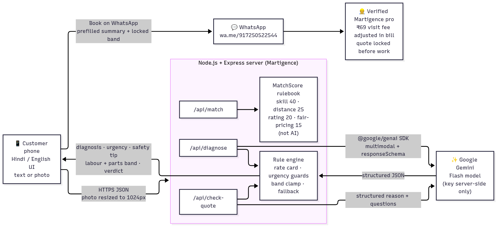
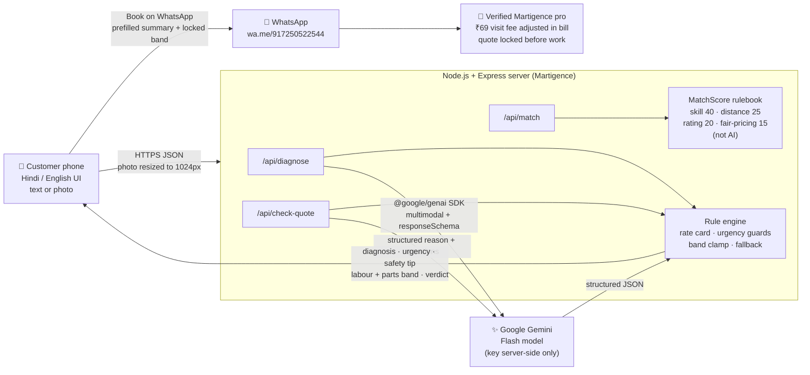

# Martigence – Dikhao aur Jano: Architecture

Home services for Deoghar, Jharkhand. A customer shows a home problem (text or photo, Hindi or English). They get the likely problem, the right pro, the urgency, a safety tip and a fair price band (labour and parts shown separately). They can check a pro's quote and book on WhatsApp with the band locked.





## Components
| Layer | What | Where |
|---|---|---|
| Frontend | Mobile-first single page, Hindi/English toggle, large text, high contrast, labelled inputs, aria-live results. Photos are resized in the browser to 1024px JPEG before upload. | `public/index.html` |
| API server | Node.js + Express. Gemini is called **only here**; the API key never reaches the browser. | `server.js` |
| Gemini integration | Official `@google/genai` SDK. Multimodal input (photo + text). `responseSchema` gives strict JSON with enums for category, urgency, job and confidence. The system prompt holds the Deoghar rate card and urgency rules. Model chain: `gemini-3.5-flash-lite` → `gemini-3.8-flash` (thinking LOW, 16 s timeout) → `gemini-3.1-flash-lite` → rule-based fallback. `gemini-2.5-flash` returns 404 for new API keys, so newer free Flash models come first. Override with `GEMINI_MODEL=` in `.env`. | `server.js` |
| Rule engine | Rate card for 18 common jobs, keyword urgency guards (sparking, gas, flooding → URGENT, whatever the model says), clamps the AI price band to within 2× of the rate card, the quote verdict, and a complete rule-based fallback. | `rules.js` |
| MatchScore | Public rulebook, **not AI**: skill 40 + distance 25 + rating 20 + fair-pricing record 15. Nobody can pay to rank higher. Uses **SAMPLE pros (example data)**. | `rules.js` |
| Booking | `wa.me/917250522544` with a prefilled summary: problem, pro, urgency, locked band, ₹69 visit fee and the checked quote. | frontend |

## API
- `POST /api/diagnose` `{text?, image? (dataURL/base64), mime?, lang:'en'|'hi'}` → `{source:'gemini'|'fallback', model, note, result{problem, category, job_key, urgency, urgency_reason, safety_tip, labour_min/max, parts_min/max, parts_list, pro_should_check, questions_for_customer, confidence, photo_seen, guard_triggered}}`
- `POST /api/check-quote` `{quote, labour_min/max, parts_min/max, problem, lang}` → `{verdict: fair|slightly_high|too_high|suspiciously_low, diff, band_total, reason, questions_to_ask_pro, above_band_rule}`. The **verdict always comes from the transparent rules**. Gemini writes the reason and the questions.
- `POST /api/match` `{category}` → top 3 sample pros with their score breakdown.
- `GET /api/health` → whether a Gemini key is present and whether the proxy key is required (never shows any key). Per-IP and daily AI caps are enforced in `server.js` (in memory, best effort).

## Trust and safety design
- **AI proposes, rules decide.** Urgency guards can only raise urgency, never lower it. Price bands are clamped to the rate card. The quote verdict is pure arithmetic.
- **Never a blank screen.** If there is no key, a timeout, a quota limit or a model error, the app shows a rule-based estimate with a friendly note.
- Quote verdict thresholds: within the band = fair; up to 25% (and ≤ ₹300) over = slightly high; more = too high; below 60% of the band's minimum = suspiciously low.

## Business rules in the product
- The price band is shown before the visit. The quote is locked on WhatsApp before work starts.
- ₹69 visit fee, adjusted in the bill.
- Above the band, the pro must send a reason and photos. The customer can get a free second quote, or pay only the ₹69 visit fee. Overcharging leads to a warning, then a 2-week pause, then removal.
- Commission is on labour only. Founding pros pay 0% on their first 5 jobs, then 10%.
- Kaam ki Guarantee: if the same fault comes back within 7 days, the same pro returns free.

## Config and running
- Key: `GEMINI_API_KEY` in a `.env` file next to `server.js`, or in the parent folder, or as an environment variable (git-ignored). The server also accepts `GEMINI_API_KEY` from the process environment, which is how a host like Vercel should inject it. **`.env` is re-read on every request**, so a new key or `GEMINI_MODEL` works without a restart.
- Start locally with `npm start`. The port is `process.env.PORT`, default `8080`.
- Copy `.env.example` to `.env` and paste your key. Never commit `.env`.

## Next on Google Cloud (once credits are available)
Cloud Run for the API, Firestore for job cards and real Deoghar prices (which replace the starting rate card), and the WhatsApp Business API webhook.

## Parts ka Sahi Daam (Parts Price Check + Bargain Helper)

```
Browser ──POST /api/parts-check──► server.js ──► Gemini (part / bill photo → JSON)
                                       │            └─ clamp to parts.js reference table (Martigence estimates)
                                       └─ verdict in code: Fair ≤ typical+15% · Slightly high ≤ high+15% · else Overcharged
Browser ──POST /api/parts-prices──► pricesearch.js ──► Amazon.in · Flipkart · Industrybuying · IndiaMART search pages
                                       ├─ parse real price + product URL (never generated)
                                       ├─ Gemini relevance filter (same part, no multi-packs) → link check → top 3 lowest
                                       └─ 10-minute in-memory cache
```
